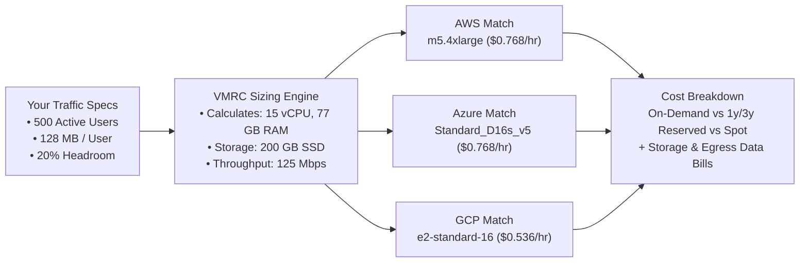

# 🖥️ VMRC — Virtual Machine Resources Calculator

> **Stop guessing cloud VM sizes in spreadsheets.**  
> Enter your traffic requirements, and VMRC instantly calculates the exact CPU, RAM, and storage you need — then finds the cheapest virtual machines across **AWS**, **Azure**, and **Google Cloud (GCP)** with live pricing.

---

## ⚡ The Real-World Workflow



---

## 📸 Dashboard Overview

```
┌────────────────────────────────────────────────────────────────────────────────────────┐
│  VMRC — Virtual Machine Resources Calculator     [● Prices: 3/3 Live] [● Cloud CLI: 1] │
├────────────────────────────────────────────────────────────────────────────────────────┤
│  [ Calculator ] [ Compare ] [ Cost Estimator ] [ Fleet Planner ] [ Right-Size ] [Saved]│
├────────────────────────────────────────────────────────────────────────────────────────┤
│                                                                                        │
│   WORKLOAD INPUTS                   TOP CHEAPEST INSTANCES                             │
│   ─────────────────                 ──────────────────────                             │
│   Active Users:     [ 500      ]    AWS:   m5.4xlarge        16 vCPU | 64GB | $0.768/h │
│   CPU per User:     [ 2.5%     ]    Azure: Standard_D16s_v5  16 vCPU | 64GB | $0.768/h │
│   RAM per User:     [ 128 MB   ]    GCP:   e2-standard-16    16 vCPU | 64GB | $0.536/h │
│   Storage Needed:   [ 200 GB   ]                                                       │
│   Safety Headroom:  [ 20%      ]    MONTHLY BILL COMPARISON                            │
│                                     AWS:   $604.22 / mo (On-Demand)                    │
│   [  Calculate Recommendations  ]   Azure: $596.15 / mo (On-Demand)                    │
│                                     GCP:   $447.88 / mo (On-Demand) ← Cheapest         │
│                                                                                        │
└────────────────────────────────────────────────────────────────────────────────────────┘
```

---

## 🚀 Key Features

* **Workload-to-VM Calculator:** Translates concurrent user count, memory per user, growth factor, and traffic headroom into exact vCPU, RAM, storage, and network bandwidth targets.
* **Top-3 Cloud Recommendations:** Instantly searches a curated catalog of **61 real-world instances** (21 AWS, 20 Azure, 20 GCP) to deliver the top 3 most cost-effective instances per cloud.
* **Live Multi-Cloud Pricing:**
  * **Azure:** Pulls live public pricing on-demand from the Microsoft Retail Prices API.
  * **AWS & GCP:** Continuously syncs live On-Demand and Spot pricing via open Vantage cloud feeds without requiring API keys or account setup.
* **1-Click Local Cloud CLI Detection:** Detects existing developer CLI logins (`aws configure`, `az login`, `gcloud auth application-default login`) directly from your machine with copyable setup instructions.
* **Right-Sizing & FinOps Waste Finder:**
  * Analyzes 14-day CPU, RAM, and Network metrics (via CSV upload, JSON, or GCP Cloud Monitoring).
  * Evaluates network saturation (>80% of link) **first** to prevent classifying network-bound servers as idle.
  * Tells you if you are `OVER_PROVISIONED` or `UNDER_PROVISIONED` and computes your **exact monthly dollar savings** if you downsize.
* **Fleet Planner:** Add multiple frontends, backends, and databases into a single group to calculate the total cluster bill.
* **Saved Scenarios & CSV Export:** Save any calculation to an embedded SQLite database and export comparisons directly to CSV spreadsheets.

---

## 🛠️ Quick Start (Run Locally in 60 Seconds)

No Docker or Node build steps required. It runs on pure Python and vanilla browser web standards.

### 1. Clone the repository
```bash
git clone https://github.com/harshabk22/VMRC.git
cd VMRC
```

### 2. Install Python dependencies
```bash
cd backend
pip install -r requirements.txt
```

### 3. Start the server
```bash
python3 -m uvicorn main:app --port 8000
```

Now open **[http://localhost:8000](http://localhost:8000)** in your browser!  
*(Interactive OpenAPI / Swagger docs are available at **[http://localhost:8000/docs](http://localhost:8000/docs)**)*

---

## 📋 What You Can Do in Each Tab

| Tab | Purpose | What You Do |
| :--- | :--- | :--- |
| **Calculator** | Find the right VM for new apps | Enter user count, RAM/user, and headroom ➔ Get the cheapest AWS, Azure, and GCP VMs. |
| **Compare** | Head-to-head spec shootout | Pick 2 or 3 instances ➔ Compare vCPUs, RAM, storage speeds, and hourly rates side-by-side. |
| **Cost Estimator** | Real-world billing breakdown | Pick a VM and enter hours + storage + egress GB ➔ View On-Demand, 1-Year Reserved (37% off), and Spot costs. |
| **Fleet Planner** | Multi-server architecture cost | Add 2 web servers + 1 database + 1 worker ➔ View the aggregated cluster cost and total vCPU/RAM. |
| **Right-Size** | Cut existing cloud waste | Paste metrics or drop a CSV/JSON monitoring export ➔ View classified status and exact monthly savings. |
| **Saved Scenarios**| Architecture plan archive | Save your calculation with a custom name ➔ Reopen or export to CSV anytime. |

---

## 📊 Live Cloud Telemetry & Right-Sizing Example

You can drag-and-drop a CSV monitoring export directly into the **Right-Size** tab:

```csv
timestamp,cpu_pct,mem_pct,net_pct
2026-10-21T10:00:00Z,14.2,42.0,8.5
2026-10-21T11:00:00Z,18.5,45.2,11.2
2026-10-21T12:00:00Z,22.1,43.8,9.4
```

VMRC computes the 95th-percentile utilization, flags that your current `m5.2xlarge` ($0.384/hr) is running at only 22% CPU, and suggests switching to an `m5.large` ($0.096/hr) — **saving you $207.36 every month**.

---

## 🧪 Automated Test Suite

VMRC includes a comprehensive test suite covering mathematical calculations, catalog boundaries, cost models, live pricing feeds, and REST endpoints:

```bash
cd backend
pytest -v
```

```text
============================= 136 passed in 1.04s ==============================
```

* **test_calculator.py (29 tests):** Boundary mathematics, headroom formulas, catalog matching.
* **test_cost_engine.py (27 tests):** Reserved discounts, provider spot multipliers, storage & egress math.
* **test_rightsizer.py (28 tests):** Percentile interpolation, network saturation priority, downsizing logic.
* **test_live.py (16 tests):** Azure Retail API parsing, Vantage AWS/GCP ingestion, CLI detection.
* **test_api.py (36 tests):** Complete FastAPI end-to-end endpoint tests and SQLite CRUD validation.

---

## 🏛️ Architecture & Tech Stack

* **Backend:** Python 3.10+, FastAPI, Uvicorn, Pydantic v2.
* **Database:** SQLite 3 (single-file local persistence for scenarios and price caches).
* **Frontend:** Responsive Dark-Mode UI (Vanilla HTML5 / Modern CSS / Vanilla ES6 JavaScript).
* **Charts:** Bundled local Chart.js 4 (fully functional offline without CDNs or tracking).
* **License:** MIT
